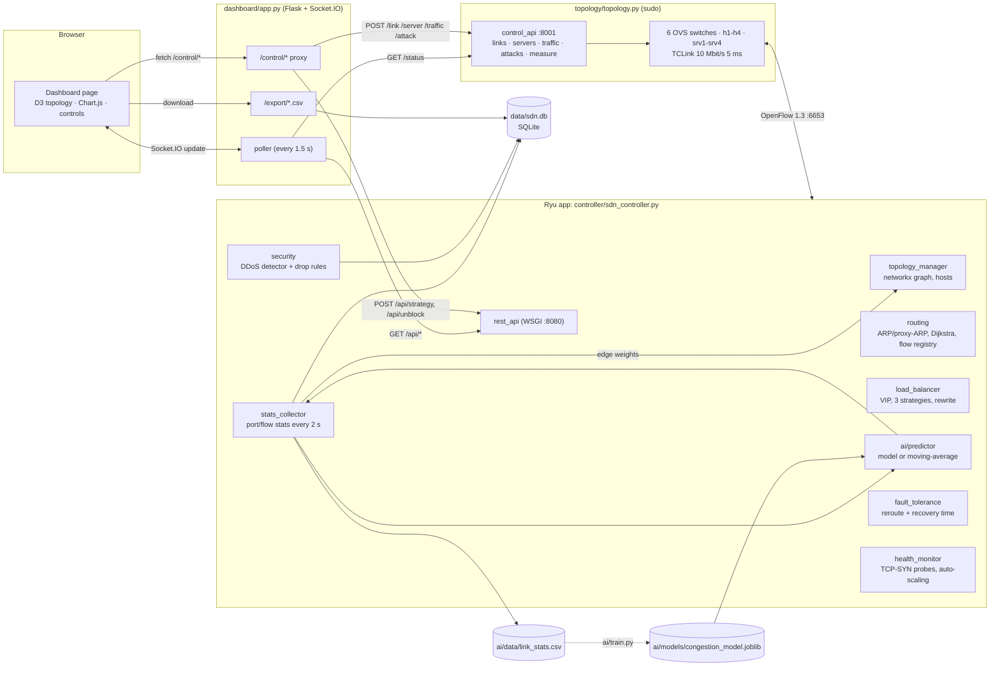
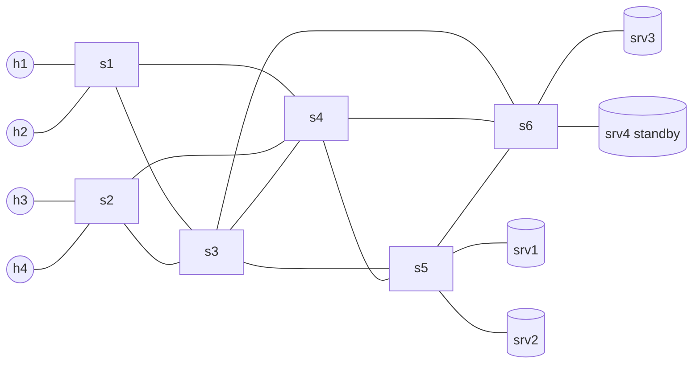

# Architecture

## Component diagram

## Emulated network

Every client has at least four loop-free paths to every server, so link failures
and congestion-aware routing always have an alternative.

| Item | Value |
|---|---|
| Clients | h1-h4, 10.0.0.1-4 |
| Servers | srv1-srv3 10.0.0.11-13 (active), srv4 10.0.0.14 (standby) |
| Virtual IP | 10.0.0.100 / 00:00:00:00:01:00 (answered by the controller) |
| Probe address | 10.0.0.254 / 00:00:00:00:02:54 (controller health checks) |
| Links | TCLink, 10 Mbit/s, 5 ms (switch-switch), 1 ms (host) |
| Controller | 127.0.0.1:6653 (OpenFlow 1.3), REST 8080 |
| Dashboard | http://localhost:5000 |
| Mininet control API | http://127.0.0.1:8001 |

## Flow-rule priorities

| Priority | Rule | Timeouts |
|---|---|---|
| 1000 | DDoS drop: `in_port, ipv4_src=attacker` | hard 60 s |
| 65535 | LLDP to controller (installed by Ryu topology app) | none |
| 20 | Load-balancer per-connection rules (with rewrite at the edges) | idle 10 s, hard 60 s |
| 10 | Host-to-host routes `ipv4_src, ipv4_dst` | idle 10 s, hard 60 s |
| 1 | Drop IPv6 | none |
| 0 | Table-miss: to controller (no buffering) | none |

All path rules carry a unique cookie (`0x5D…`), which lets the controller delete
one path precisely, map flow statistics back to it, and clear stale rules after a
controller restart without touching the LLDP rule.
