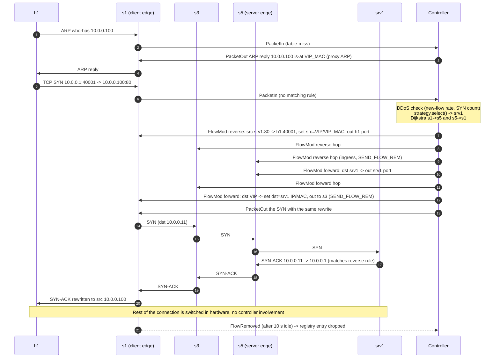

# OpenFlow message flow for a new client request

Scenario: h1 (10.0.0.1, on s1) opens `http://10.0.0.100/` for the first time.
Strategy round_robin picks srv1 (10.0.0.11, on s5); the cheapest path is s1-s3-s5.

Notes

1. **Egress first.** Rules are installed from the last hop back to the first, and
   the reverse direction before the forward one, so no packet of the connection
   can reach a switch that has no rule yet.
2. **Rewrite only at the client's edge switch.** The core sees real server
   addresses; the client only ever sees the VIP. OVS recomputes IP/TCP checksums.
3. **Server ARP.** When srv1 answers it needs h1's MAC; its ARP request reaches
   the controller, which answers from its host table (proxy ARP). No broadcast
   crosses an inter-switch link.
4. **Statistics.** Every 2 s the controller sends `OFPPortStatsRequest` and
   `OFPFlowStatsRequest` to every switch; the replies give link utilisation and
   per-connection packet counts (used for DDoS detection and active-flow counts).
5. **Link failure.** `OFPPortStatus` (link down) → controller deletes the rules of
   every path that used the link (`OFPFC_DELETE` by cookie), installs new paths,
   then sends `OFPBarrierRequest`; recovery time is measured to the last
   `OFPBarrierReply`.
6. **Health check.** The controller injects a TCP SYN from 10.0.0.254 to port 80 of
   each server with `OFPPacketOut`; the SYN-ACK (or RST) returns as `OFPPacketIn`.
